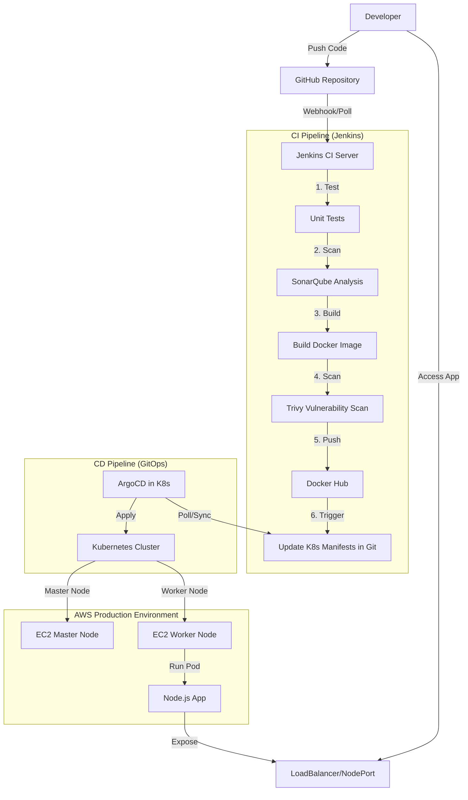

# End-to-End CI/CD Pipeline with GitOps

A production-ready DevOps project showcasing a complete CI/CD workflow using **Jenkins**, **ArgoCD**, and a **Manually Provisioned Kubernetes Cluster (Kubeadm)** on AWS.

## 🚀 Project Overview

This project demonstrates deep "under the hood" knowledge by creating a Kubernetes cluster from scratch on EC2 instances, rather than using managed services like EKS. It implements a GitOps pipeline for deployment.

### Key Features

- **Manual Cluster Setup**: Hard-way installation using `kubeadm` on Ubuntu EC2 instances.
- **Continuous Integration (CI)**: Jenkins pipeline for building, testing, and security scanning (Trivy + SonarQube).
- **Continuous Deployment (CD)**: GitOps workflow with ArgoCD.
- **Microservices**: A sample Node.js application with health checks.
- **Network Architecture**: Custom VPC and Security Group configuration.

---

## 🏗️ Architecture



1. **Code Commit**: Developer pushes code to GitHub.
2. **CI Trigger**: Jenkins detects changes and runs tests/scans.
3. **Build & Push**: Docker image pushed to Docker Hub.
4. **Update Manifest**: Jenkins updates the image tag in `k8s/` folder.
5. **Sync**: ArgoCD (running on the self-managed cluster) pulls changes and updates deployments.

---

## 🛠️ Technology Stack

| Component | Technology | Reason for Choice |
| :--- | :--- | :--- |
| **Cluster** | Kubeadm on EC2 | To demonstrate deep understanding of K8s architecture & troubleshooting. |
| **IaC (Optional)**| Terraform | Use for VPC networking (or do it manually). |
| **CI Server** | Jenkins | Highly extensible, granular control. |
| **CD / GitOps** | ArgoCD | Declarative, self-healing, pull-based model. |

👉 **[Read full Technology Justification](docs/justification.md)**

---

## ⚙️ Setup & Installation

### Step 1: Provision Infrastructure (The Hard Way)

Follow the detailed guide to setup the Kubernetes cluster manually.
👉 **[Manual Cluster Setup Guide (Kubeadm)](docs/manual_cluster_setup.md)**

### Step 2: Deploy Application (GitOps)

Once your cluster is ready:

```bash
kubectl apply -f k8s/
```

### Step 3: Configure CI Pipeline

1. Install Jenkins on a separate EC2 or on the cluster.
2. Configure credentials and point to this `Jenkinsfile`.

---

## 🐛 Issues Faced & Troubleshooting

Building a cluster manually comes with challenges. We documented them:

- **CNI Plugin Issues**: Calico networking conflicts.
- **Swap Memory**: Kubelet failing due to enabled swap.
- **Security Groups**: Nodes failing to join due to closed ports.

👉 **[Read detailed Issues & Fixes Log](docs/issues.md)**

---

## 🧪 Verification

1. `kubectl get nodes` - Ensure Master and Worker are READY.
2. Access the application via the Worker Node's Public IP (NodePort) or LoadBalancer.
